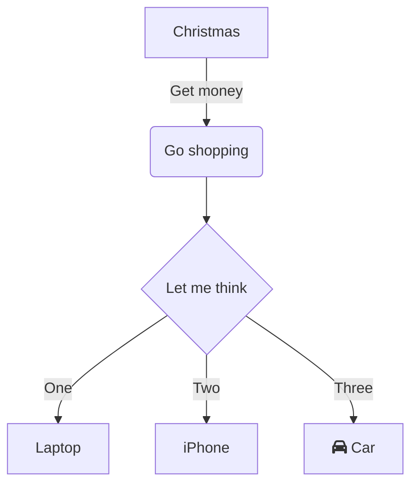
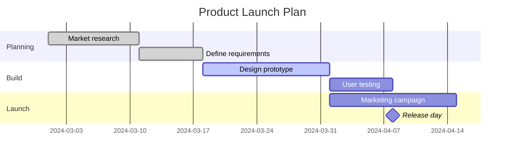

# Internet pour les nuls
---
![[Pasted image 20261027113928.png]]

test
test
---

# test

$$
\prod_{\in \frac{d \to \longleftarrow \subset \bigcup_{}^{}}{dx}}^{}
$$
---







---
2026-10-27

```stats
a
```
---
# Truc !
Les trucs !
* oui
* non 
* peut être


